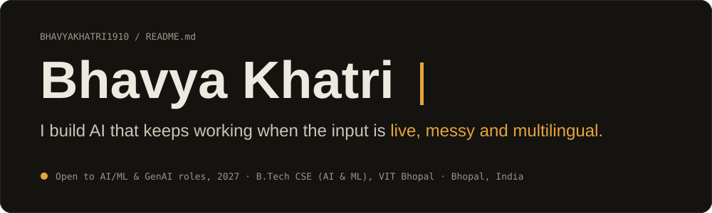
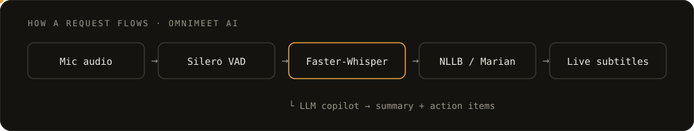

 
 <a href="https://linkedin.com/in/bhavya-khatri-ml/"><b>LinkedIn ↗</b></a> &nbsp;&nbsp;·&nbsp;&nbsp;<a href="https://mail.google.com/mail/?view=cm&to=bhavyakhatri1910@gmail.com"><b>Email ↗</b></a> &nbsp;&nbsp;·&nbsp;&nbsp; <a href="https://cool-starship-629a9c.netlify.app/"><b>Portfolio ↗</b></a> 
     
SELECTED WORK
<table> <tr> <td width="50%" valign="top"> <b>OmniMeet AI</b>  Live captions and translation for video calls, plus an LLM meeting copilot. I own the AI services layer.   <code>FastAPI</code> · <code>WebSockets</code> · <code>Whisper</code> · <code>NLLB</code> </td> <td width="50%" valign="top"> <b>RecovAI</b>  Explainable ML for a copper plant, built with a team during my Hindustan Copper internship.   <code>XGBoost</code> · <code>SHAP</code> · <code>FastAPI</code> · <code>drift monitoring</code> </td> </tr> <tr> <td width="50%" valign="top"> <b>SkillSync AI</b>  Hiring platform that matches candidates to roles by meaning, not keywords.   <code>Spring AI</code> · <code>pgvector</code> · <code>Java</code> </td> <td width="50%" valign="top"> <b><a href="https://github.com/BHAVYAKHATRI1910/Exploratory-Analysis-on-Rainfall">RainCast AI</a></b>  Next-day rainfall prediction served as a Flask app, from the SmartBridge × Google for Developers internship.   <code>scikit-learn</code> · <code>Flask</code> </td> </tr> </table>   <table> <tr> <td width="50%" valign="top">
NOW
Shipping a live demo
AWS Solutions Architect exam
Tests and CI on my main repos
</td> <td width="50%" valign="top">
ASK ME ABOUT
Why VAD comes before Whisper
What SHAP changes for an operator
Streaming latency vs accuracy
</td> </tr> </table>
